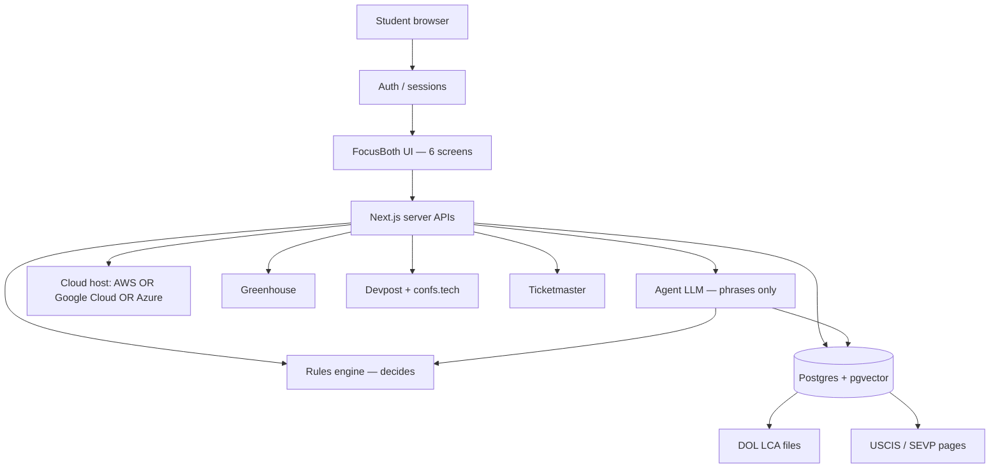

# FocusBoth — Cloud + Agent Architecture

Jessica  |  Capstone target architecture  |  9 September 2026  
**Cloud vendor is not locked.** Course requirement is *cloud-hosted*, not a named provider.  
**Deploy on: AWS *or* Google Cloud *or* Azure** (one of the three). The application code stays the same.

---

## 1. One-sentence design

A signed-in student uses FocusBoth in the cloud. An **agent (LLM)** may call tools. A **rules engine** still decides pass/fail. The model **only explains** those results and **cited** USCIS/SEVP passages. Nothing personal stays only in the browser.

**Governing rule:** the rules engine decides; the language model only explains.

---

## 2. Runtime picture (vendor-neutral)

```
Student (logged in)
    → FocusBoth web app  (Next.js, hosted in the cloud)
         → Agent (LLM)
              ├─ Tool: visa clock          (dates in Postgres)
              ├─ Tool: job feed             (Greenhouse)
              ├─ Tool: sponsorship signal    (DOL LCA in Postgres)
              ├─ Tool: wellbeing hours      (goals in Postgres)
              ├─ Tool: events               (Devpost / confs.tech / Ticketmaster)
              └─ Tool: retrieve policy      (USCIS/SEVP RAG + URL citations)
         → Rules engine  (TypeScript, auditable)
         → Agent returns explanation + citations only
    → Postgres  (profiles, jobs, paths, goals, LCA aggregates, document chunks)
```



---

## 3. Layers

| Layer | What it is | Status |
|---|---|---|
| Presentation | Six screens: Today, Visa Clock, Job Hunt, Paths, Wellbeing, Discover | Built |
| Application APIs | `/api/openings`, `/api/salaries`, `/api/events` | Built |
| Domain | `compass-engine.ts` (constraints), salary/location parsers | Built |
| Persistence | Student data | **Today:** browser `localStorage`. **Target:** Postgres, not local |
| Agent | Tool-calling LLM + RAG | Planned |
| Cloud | Auth + database + public URL | Planned — **AWS *or* GCP *or* Azure** |

---

## 4. Cloud options (OR — pick one)

Same jobs on every vendor. Do **not** run all three.

| Need | **AWS** | **or Google Cloud** | **or Azure** |
|---|---|---|---|
| Run the Next.js app | Amplify **or** App Runner **or** ECS | **Cloud Run** | **App Service** |
| Postgres | RDS PostgreSQL | Cloud SQL for PostgreSQL | Azure Database for PostgreSQL |
| Vectors for RAG | pgvector on that Postgres | same | same |
| Login | Amazon Cognito | Identity Platform / Firebase Auth | Microsoft Entra ID / App Service auth |
| Secrets | Secrets Manager | Secret Manager | Key Vault |
| Optional LLM on-cloud | Bedrock | Vertex AI | Azure OpenAI |
| Student-ID path | Educate / Free Tier / school AWS Academy credits | Course or faculty GCP credits, or free trial | **Azure for Students (~$100, often no card)** |

**Also allowed (still cloud, not localhost):** host the Next.js UI on **Vercel Hobby** and attach Postgres from **whichever** of AWS / GCP / Azure you chose. The professor still sees a public URL and a cloud database.

Lock the vendor after the call. Until then every diagram and the proposal stay written as **OR**.

---

## 5. Agent tools (what the LLM is allowed to call)

| Tool | Reads | Must not do |
|---|---|---|
| Visa clock | Profile dates, unemployment days | Invent a legal status |
| Job feed | Cached Greenhouse openings | Scrape LinkedIn / Indeed |
| Sponsorship signal | LCA aggregates in Postgres | Promise that a company will sponsor |
| Wellbeing | Weekly hour goals | Diagnose or treat mental health |
| Events | Devpost / conferences / Ticketmaster | Scrape Instagram / Google Events |
| Policy retrieve | USCIS/SEVP chunks | Answer with no citation; if retrieval is empty → “ask your DSO” |

The agent **does not** compute feasibility. It calls the engine (or receives engine JSON) and writes English around it.

---

## 6. Rules engine (unchanged, still the source of truth)

- Unemployment cap: 90 days (OPT) or 150 (STEM OPT).  
- Job pass: sponsor signal ≥ 60 **and** résumé-fit ≥ 65 **and** start date ≤ EAD end.  
- Path pass: start before EAD end **and** ≥ 20 hours/week **and** E-Verify **and** employer relationship.  
- Every visa-facing sentence ends with: confirm with DSO / not legal advice.

---

## 7. Data: what leaves the laptop

| Store | Contents | Local today? | Cloud target |
|---|---|---|---|
| User profile, jobs, paths | Yes (`localStorage`) | Move to Postgres | |
| Wellbeing goals | Yes | Move to Postgres | |
| Saved events | Yes | Move to Postgres | |
| Job/event API cache | Server memory/cache | Keep as cache, not the student record | |
| LCA filings | Not loaded | Batch into Postgres | |
| USCIS chunks | Not built | Embeddings + pgvector | |
| Agent chat log | None | Optional table, same user id | |

---

## 8. Security and boundaries

- Immigration dates are personal data: authenticated user only, row-level isolation.  
- API keys (Ticketmaster, LLM) live in the cloud secret store, never in the browser.  
- The app never submits a job application; it opens the employer’s posting URL.  
- Not a lawyer. Not a therapist. Crisis: 988.

---

## 9. Build order (still 3-week first slice)

1. Pick **one** of AWS **or** GCP **or** Azure (or Vercel + that vendor’s Postgres).  
2. Auth + Postgres + public URL — delete `localStorage` as source of truth.  
3. Load LCA into Postgres; replace mock sponsor scores.  
4. RAG + agent tools, with the engine still deciding.

---

*FocusBoth is informational decision support. It does not provide legal advice, determine immigration status, submit applications, or offer clinical care.*
